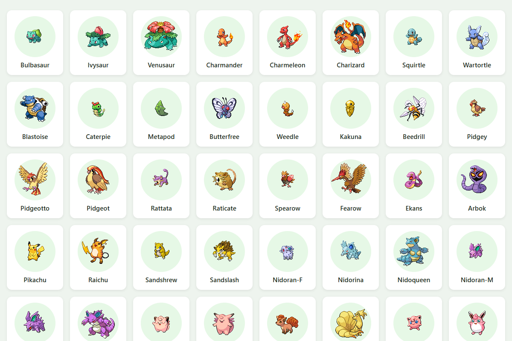
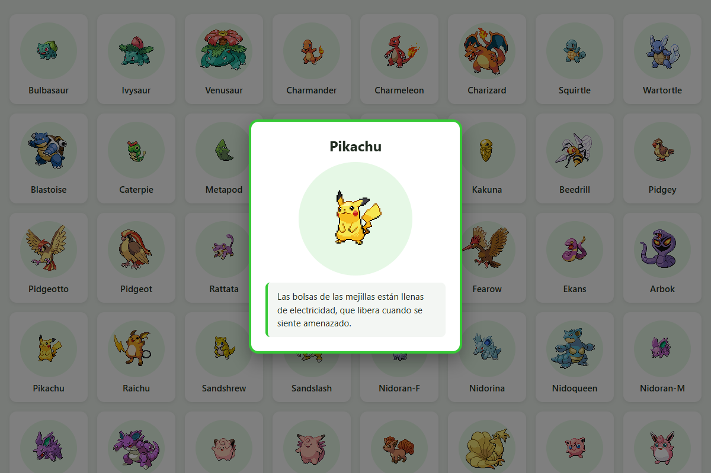

# PokedexWeb

Pokédex web hecha con HTML, CSS y JavaScript puro, sin frameworks, dependencias ni proceso de compilación. Obtiene los datos de [PokéAPI](https://pokeapi.co/) y guarda el detalle de cada pokémon en IndexedDB para no volver a pedirlo.





## Características

- **Lista con scroll infinito**: carga los pokémon de 20 en 20 a medida que se baja por la página.
- **Ficha de cada pokémon**: ventana modal con su nombre, imagen y descripción en español (o en inglés si no hay traducción).
- **Enlaces directos**: la ficha abierta se refleja en la URL, por ejemplo `#pikachu`, y se puede compartir o abrir directamente.
- **Caché local**: los pokémon ya descargados se leen de IndexedDB.
- **Diseño adaptable**: el número de columnas se ajusta al ancho de la pantalla.

## Puesta en marcha

Necesitas un navegador moderno, conexión a internet y cualquier servidor de archivos estáticos. Con Python, por ejemplo:

```bash
git clone https://github.com/Destructor266/pokedexWeb.git
cd pokedexWeb
python -m http.server 5500
```

Después abre <http://localhost:5500>. También sirve la extensión Live Server de VS Code.

## Uso

| Acción | Cómo |
| --- | --- |
| Cargar más pokémon | Baja hasta el final de la lista |
| Abrir una ficha | Pulsa sobre un pokémon |
| Cerrar la ficha | Pulsa `Esc` o haz clic fuera de ella |
| Ir directamente a un pokémon | Añade `#nombre` a la URL: <http://localhost:5500/#pikachu> |

## Estructura

```
pokedexWeb/
├── index.html   # Contenedor de la lista y <dialog> de la ficha
├── index.css    # Estilos de la lista y del modal
├── index.js     # Llamadas a la API, caché, scroll infinito y modal
└── capturas/    # Imágenes de este README
```

## Cómo funciona

### Carga de la lista

Por cada página de 20 pokémon:

1. Se pide a la API la lista de nombres.
2. Se buscan todos esos nombres en IndexedDB.
3. Se descarga en paralelo el detalle de los que falten y se guarda en la caché.
4. Se pintan todos en el orden original.

Si la lista no llena la pantalla, se sigue cargando automáticamente. La consola del navegador indica cuántos pokémon de cada página vienen de la caché y cuántos de la API.

### Ficha

El hash de la URL decide qué ficha se muestra: al cambiar, se abre, actualiza o cierra el modal. La descripción se pide la primera vez que se abre la ficha y se guarda junto al resto de datos del pokémon. Si no se puede obtener, la ficha se muestra sin ella y se vuelve a intentar la próxima vez.

### Caché

| Elemento | Valor |
| --- | --- |
| Base de datos | `pkmnDex` (versión 4) |
| Object store | `pkmns` |
| Clave primaria | `id` |
| Índice | `name` (único) |

Los datos guardados no caducan. Para vaciar la caché, ejecuta esto en la consola del navegador, cierra las demás pestañas de la aplicación y recarga:

```js
indexedDB.deleteDatabase("pkmnDex");
```

### Endpoints de PokéAPI

| Endpoint | Para qué se usa |
| --- | --- |
| `/pokemon/?limit=20&offset=N` | Nombres de cada página |
| `/pokemon/{id o nombre}/` | Detalle e imagen |
| `/pokemon-species/{id}/` | Descripción |

## Configuración

Las constantes están al principio de `index.js`:

| Constante | Valor | Descripción |
| --- | --- | --- |
| `API_BASE_URL` | `https://pokeapi.co/api/v2` | URL base de la API |
| `numeroPaginasPorRegistro` | `20` | Pokémon que se piden por página |
| `margenCarga` | `100` | Distancia al final de la lista, en píxeles, a la que se pide la siguiente página |

## Limitaciones conocidas

- No funciona sin conexión: la caché guarda el detalle de los pokémon, pero los nombres de cada página se piden siempre a la API.
- Si falla la carga de la lista, el error solo aparece en la consola.
- Algunas formas alternativas no tienen imagen en la API y se muestran solo con el círculo de fondo.

## Créditos

Datos e imágenes de [PokéAPI](https://pokeapi.co/). Pokémon y los nombres de sus personajes son marcas de Nintendo, Game Freak y The Pokémon Company. Este proyecto no tiene relación con ellas.
